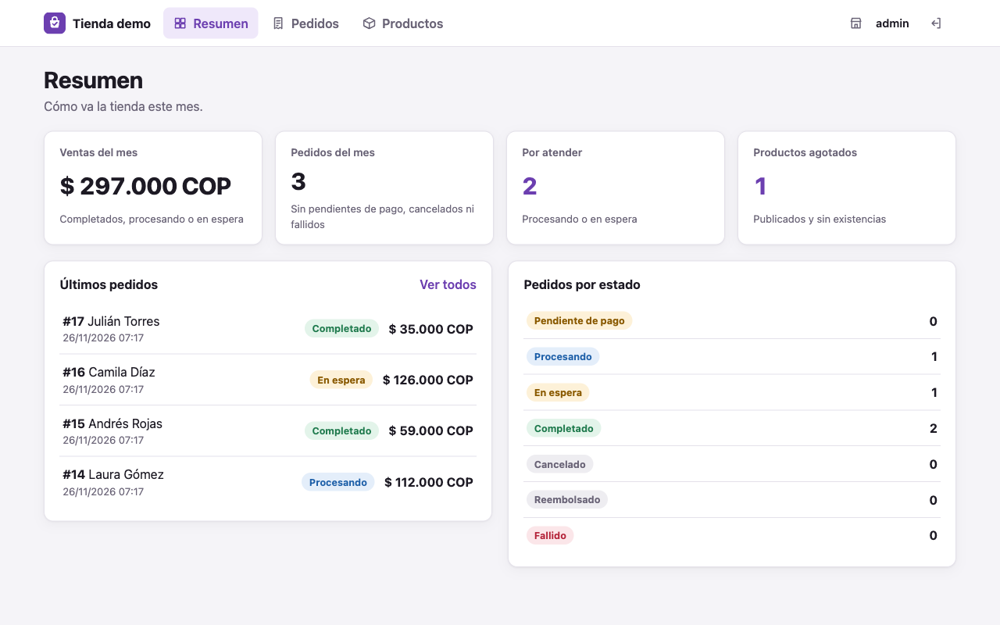
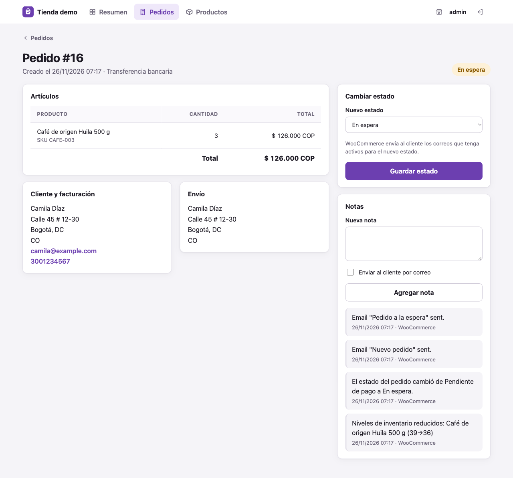
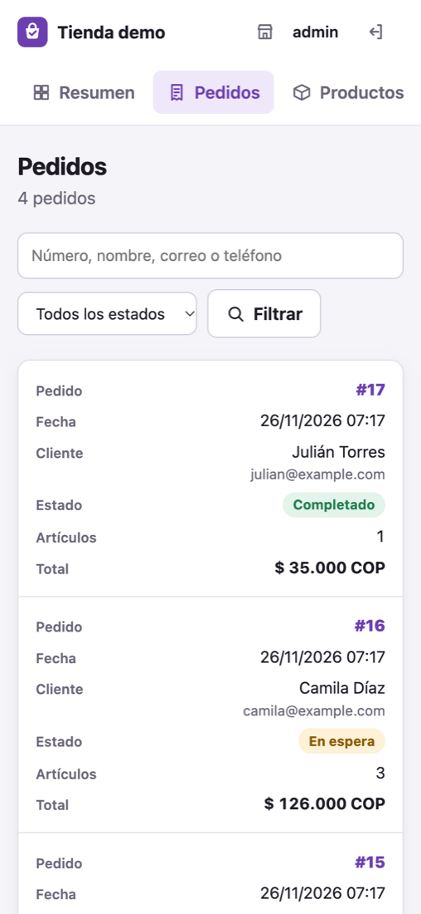
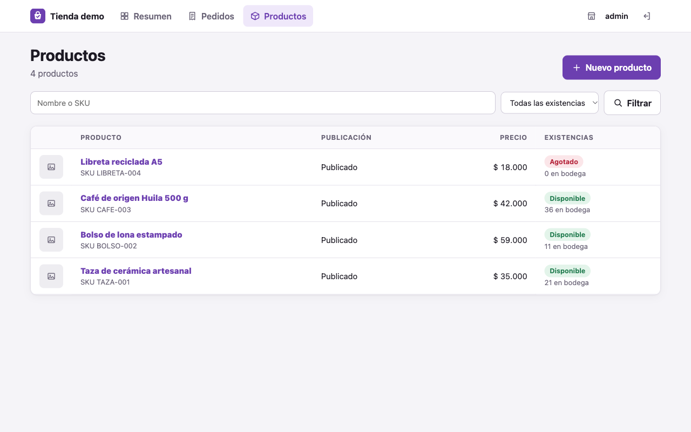
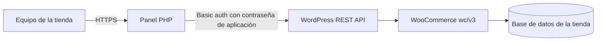

# Panel administrativo para WooCommerce en PHP

[](https://github.com/KevinAndrey96/php-woocommerce-admin-panel/actions/workflows/ci.yml)


**Panel de administración independiente (back-office) para tiendas WooCommerce**, escrito en PHP 8.3+ sin framework. Permite al equipo de una tienda revisar las ventas del mes, atender pedidos y mantener el catálogo de productos desde una interfaz rápida, clara y en español, sin entrar al escritorio de WordPress.

Se conecta **solo por la API REST oficial de WooCommerce y WordPress**, con las contraseñas de aplicación de cada persona. No necesita acceso a la base de datos de la tienda ni instalar plugins.



## Qué hace

- **Resumen del mes:** ventas, número de pedidos, pedidos por atender, productos agotados, últimos pedidos y conteo por estado.
- **Pedidos:** búsqueda por número, nombre, correo o teléfono; filtro por estado; paginación; detalle con artículos, envío, descuentos, datos de facturación y envío, y nota del cliente.
- **Gestión de pedidos:** cambio de estado (WooCommerce envía los correos que tenga activos) y notas internas o visibles para el cliente.
- **Productos:** búsqueda por nombre o SKU, filtro por existencias, creación y edición de productos simples (precio normal y de oferta, SKU, inventario, estado de publicación, descripción corta) y envío a la papelera de WordPress.
- **Imágenes:** subida validada (JPG, PNG o WebP de máximo 5 MB, tipo real detectado con `finfo`) a la biblioteca de medios de WordPress.
- **Diseño adaptable:** en el celular las tablas se convierten en tarjetas legibles.

| Detalle de un pedido | Pedidos en el celular |
| :---: | :---: |
|  |  |



## Por qué la API REST y no la base de datos

Muchos paneles externos para WooCommerce leen y escriben directo en las tablas `wp_posts` y `wp_postmeta`. Eso trae tres problemas:

1. **Se salta la lógica de WooCommerce:** no se descuentan existencias, no se envían correos de estado, no se recalculan tablas de búsqueda ni se ejecutan los hooks de otros plugins.
2. **Se rompe con HPOS:** desde WooCommerce 8 los pedidos viven en tablas propias (`wc_orders`), así que las consultas a `wp_posts` devuelven datos viejos o vacíos.
3. **Exige credenciales de la base de datos** en un servidor adicional.

Este panel usa los endpoints `wc/v3/*` y `wp/v2/*`. Así respeta las reglas de la tienda, funciona con HPOS y con cualquier hosting, y deja en el historial del pedido quién hizo cada cambio.

## Seguridad

| Riesgo | Medida |
| :--- | :--- |
| Credenciales compartidas | Cada persona ingresa con **su usuario de WordPress y una contraseña de aplicación** propia, que puede revocar en cualquier momento. WordPress verifica la capacidad `manage_woocommerce` (roles *Gestor de la tienda* y *Administrador*). |
| Robo de sesión | La contraseña de aplicación se guarda en la sesión **cifrada con libsodium** (`APP_KEY`); la cookie es `HttpOnly`, `SameSite=Lax` y `Secure`. Se regenera el ID al ingresar y la sesión vence tras 30 minutos de inactividad u 8 horas en total. |
| Fuerza bruta | Bloqueo de 15 minutos tras 5 intentos fallidos, por IP y por usuario. |
| CSRF | Token por sesión en todos los formularios y comparación en tiempo constante. |
| XSS y clickjacking | Escape de toda salida, Content Security Policy sin scripts ni estilos en línea, `X-Frame-Options: DENY`, `nosniff` y `Referrer-Policy`. |
| Subidas maliciosas | Se valida el tipo real del archivo y que sea una imagen; el nombre se normaliza y solo se aceptan archivos subidos por la petición actual. |
| Fallos de red | Tiempos de espera en cada llamada; reintentos con espera creciente solo en operaciones idempotentes (GET, PUT, DELETE), nunca en POST, para no duplicar notas ni productos. |

## Arquitectura

Arquitectura limpia en capas, sin dependencias en producción (solo extensiones estándar de PHP):

```text
src/
├── Domain/          Pedido, producto, estados, dinero y validación de borradores (sin I/O)
├── Application/     Puertos (interfaces), consultas, errores de la tienda y caso de uso SaveProduct
├── Infrastructure/
│   ├── Http/            Cliente HTTP con cURL detrás de una interfaz
│   ├── WooCommerce/     Cliente REST con reintentos, mapeo de recursos y gateways
│   └── Security/        Bóveda de credenciales (libsodium) y limitador de intentos
├── Http/            Front controller, rutas, sesión, CSRF y controladores
└── View/            Plantillas PHP con escape obligatorio
templates/           Vistas en español
public/              index.php, CSS y JavaScript de mejora progresiva
docker/              Apache, PHP, tienda demo con WP-CLI y prueba de extremo a extremo
```



Los controladores solo conocen interfaces (`OrderGateway`, `ProductGateway`, `ReportGateway`, `MediaGateway`, `StoreConnector`), por eso las pruebas usan implementaciones en memoria y el panel podría conectarse a otra fuente sin tocar la interfaz.

## Puesta en marcha local

Requisitos: Docker y `make`.

```bash
make up            # crea .env con APP_KEY, levanta WordPress + WooCommerce con datos demo y el panel
make credentials   # muestra el usuario y la contraseña de aplicación para ingresar
```

- Panel: <http://localhost:8080>
- Tienda demo: <http://localhost:8081> (WordPress 7, WooCommerce, pesos colombianos y español de Colombia)

El contenedor `store-setup` instala la tienda con WP-CLI, crea productos y pedidos de ejemplo y genera una contraseña de aplicación nueva en cada arranque.

## Despliegue

1. La tienda debe responder por **HTTPS** (WordPress solo habilita las contraseñas de aplicación con SSL) y tener los enlaces permanentes activos para que exista `/wp-json/`.
2. Construye la imagen con `docker build -t panel-tienda .`; corre como `www-data` en el puerto 8080 y expone `/healthz` para el balanceador.
3. Configura las variables de entorno:

| Variable | Obligatoria | Descripción |
| :--- | :---: | :--- |
| `WOOCOMMERCE_URL` | Sí | URL de la tienda vista desde el servidor del panel. |
| `WOOCOMMERCE_PUBLIC_URL` | No | URL pública para enlaces e imágenes; por defecto la anterior. |
| `APP_KEY` | Sí | 32 bytes aleatorios en base64 (`make key`). Cambiarla cierra todas las sesiones. |
| `STORE_NAME` | No | Nombre que se muestra en el panel. |
| `APP_TIMEZONE` | No | Zona horaria de las fechas; por defecto `America/Bogota`. |
| `APP_SECURE_COOKIES` | No | `false` solo en desarrollo local sin HTTPS. |
| `APP_TRUST_PROXY` | No | `true` solo detrás de un proxy que fije `X-Forwarded-Proto`. |
| `APP_STORAGE` | No | Carpeta de sesiones y del limitador; compartida si hay varias réplicas. |

Cada integrante crea su contraseña de aplicación en *Usuarios → Perfil → Contraseñas de aplicación* y la usa para ingresar.

## Pruebas y calidad

```bash
make install   # dependencias de desarrollo con Composer en Docker
make check     # PHP CS Fixer (PER-CS 2.0), PHPStan nivel max con reglas estrictas y PHPUnit
make e2e       # flujo completo contra la tienda demo levantada con make up
```

- **101 pruebas unitarias y HTTP:** validación de productos y precios, mapeo de recursos REST, reintentos y manejo de errores del cliente, cifrado de la sesión, limitador de intentos, CSRF, vencimiento de sesión, permisos y escape de datos.
- **Prueba de extremo a extremo** en CI contra un WordPress con WooCommerce real: ingreso, resumen, cambio de estado, notas, creación y envío a la papelera de un producto, rechazo de formularios sin token y cierre de sesión.
- CI en PHP 8.3, 8.4 y 8.5; Dependabot para Composer, Docker y GitHub Actions.

## Historia del proyecto

La primera versión (2021, *AdminT v1.2*) fue un panel a la medida para la tienda WooCommerce de un cliente: leía las tablas de WordPress con SQL armado a mano y se apoyaba en una plantilla de administración de terceros. En 2026 lo reescribí desde cero sobre la API REST, con arquitectura limpia, pruebas automatizadas y prácticas de seguridad actuales. La versión original queda en la etiqueta `v0.1-legacy` como referencia.

## Autor

**Kevin Andrey Herrera Silva**, desarrollador backend. [GitHub](https://github.com/KevinAndrey96)

## Licencia

Sin licencia de código abierto. El proyecto nació como trabajo para un cliente y se publica como muestra de portafolio: todos los derechos reservados.
